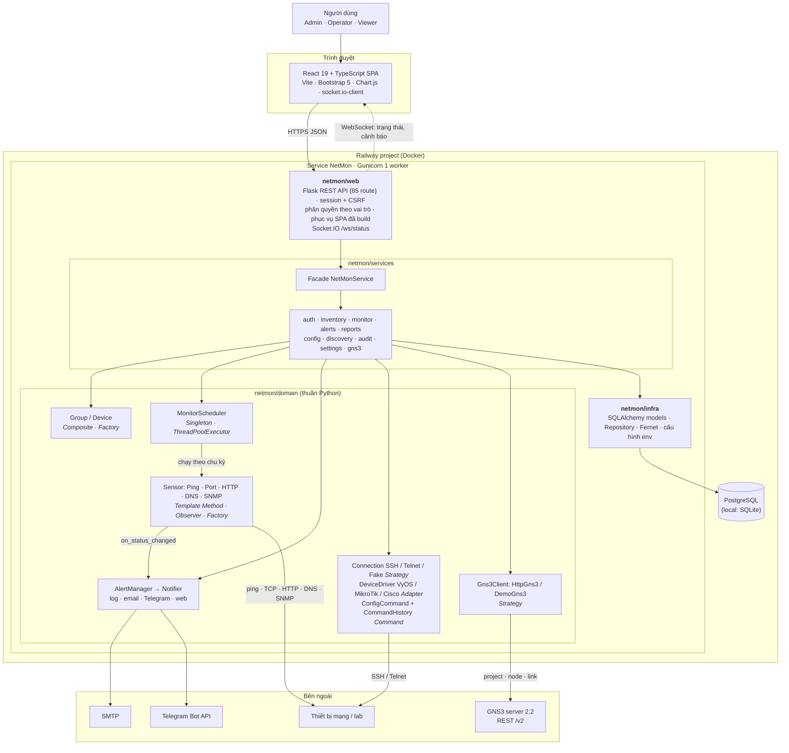

# Kiến trúc NetMon

- Phụ thuộc chỉ đi từ ngoài vào trong: `web` → `services` → `domain`; `domain` không import Flask hay SQLAlchemy.
- Kết quả mỗi lần check được ghi vào CSDL và đẩy realtime tới trình duyệt; đổi trạng thái thì `AlertManager` tạo cảnh báo và gửi thông báo.
- Chạy 1 worker vì scheduler là singleton trong tiến trình. Railway không vào được lab/GNS3 trên laptop: giám sát lab thật thì chạy local (`docker compose up` hoặc `python run.py`).
